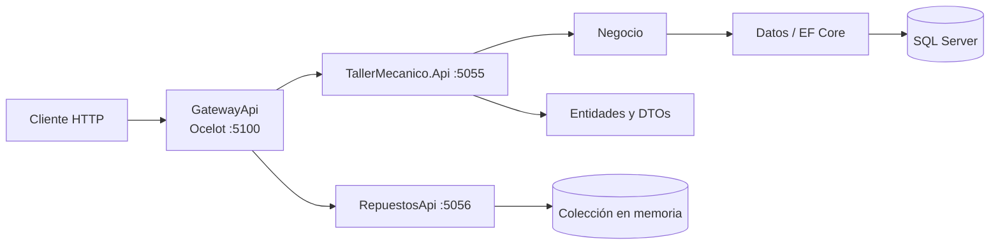

# Laboratorio 15 — Microservicios con Ocelot

El cliente entra por `GatewayApi` en `http://localhost:5100`. Ocelot valida el JWT en las rutas protegidas y reenvía las solicitudes a dos procesos independientes. `TallerMecanico.Api` conserva las cuatro capas, SQL Server, las reglas de negocio y la autorización por rol de la semana 14. `RepuestosApi` consulta un catálogo fijo de ocho repuestos en memoria, sin base de datos ni referencias a los proyectos del taller.



| Proyecto | Responsabilidad | Puerto local |
|---|---|---:|
| `GatewayApi` | Enrutamiento, validación JWT; sin lógica de negocio ni base de datos | 5100 |
| `TallerMecanico.Api` | Clientes, vehículos, registro, login y roles | 5055 |
| `RepuestosApi` | Lectura autenticada de repuestos en memoria | 5056 |

## Dependencias y configuración

Los proyectos usan .NET 10. `GatewayApi` agrega Ocelot **25.0.3** y `Microsoft.AspNetCore.Authentication.JwtBearer` **10.0.15**. `RepuestosApi` agrega JwtBearer **10.0.15**. La API original conserva JwtBearer **10.0.***, EF Core SQL Server **10.0.15**, AutoMapper **16.3.0** y BCrypt.Net-Next **4.2.0**.

En desarrollo, los tres proyectos comparten el identificador de **User Secrets** `TallerMecanico.Api`; esto permite leer exactamente la misma clave, emisor y audiencia sin copiar secretos ni compartir código. Configure una sola vez:

```bash
cd /Users/alexis/TallerMecanico
dotnet user-secrets set "Jwt:Clave" "<clave aleatoria de 32 bytes o más>" --project TallerMecanico.Api
dotnet user-secrets set "Jwt:Emisor" "TallerMecanico" --project TallerMecanico.Api
dotnet user-secrets set "Jwt:Audiencia" "TallerMecanico.Clientes" --project TallerMecanico.Api
dotnet user-secrets set "Jwt:Minutos" "60" --project TallerMecanico.Api
dotnet user-secrets set "ConnectionStrings:TallerMecanico" "<cadena SQL Server>" --project TallerMecanico.Api
```

La conexión solo la usa `TallerMecanico.Api`. Para producción, suministre las variables de [`.env.example`](.env.example) como configuración del proveedor; ese archivo es una plantilla y **no contiene credenciales reales**. `Jwt__Clave`, `Jwt__Emisor` y `Jwt__Audiencia` deben ser idénticas en los tres procesos; `Jwt__Minutos` es necesario en la API que emite tokens. `ConnectionStrings__TallerMecanico` solo va en la API original. En los contenedores, `PORT` determina el puerto HTTP y los tres procesos escuchan en `0.0.0.0`; el valor predeterminado del Dockerfile es 8080 y Render suele proporcionar 10000. Fuera de Docker, ASP.NET Core admite también `ASPNETCORE_URLS` y `ASPNETCORE_HTTP_PORTS`.

En producción, `GatewayApi` exige `Downstream__TallerMecanico__Host`, `Downstream__Repuestos__Host` y `Gateway__BaseUrl`. Indique únicamente los nombres DNS de los microservicios, sin `https://` ni puerto, y la URL HTTPS pública completa del gateway. Al arrancar con `ASPNETCORE_ENVIRONMENT=Production`, el gateway sustituye los destinos locales por HTTPS y puerto 443. La configuración base local permanece en `GatewayApi/ocelot.json`. No se han creado dominios ni recursos en la nube.

## Inicio local en macOS

Antes de iniciar, asegúrese de que SQL Server esté disponible para la cadena local y de haber ejecutado `database/TallerMecanico.sql` cuando corresponda. La ausencia de SQL Server impide las rutas de clientes, vehículos, registro y login; el gateway y RepuestosApi pueden iniciar igualmente.

```bash
cd /Users/alexis/TallerMecanico
dotnet restore TallerMecanico.slnx
dotnet build TallerMecanico.slnx --no-restore
```

Abra **tres terminales** y ejecute uno de estos bloques en cada una:

```bash
cd /Users/alexis/TallerMecanico
dotnet run --no-build --project TallerMecanico.Api --launch-profile http
```

```bash
cd /Users/alexis/TallerMecanico
dotnet run --no-build --project RepuestosApi --launch-profile http
```

```bash
cd /Users/alexis/TallerMecanico
dotnet run --no-build --project GatewayApi --launch-profile http
```

Detenga RepuestosApi con **Ctrl+C** en su terminal. La consulta autenticada a `/gateway/repuestos` devuelve **502** en Ocelot 25.0.3 cuando el proceso no está disponible; `/gateway/auth/perfil` continúa respondiendo desde TallerMecanico. Vuelva a iniciarlo con el segundo comando.

## Rutas reales

Todas las rutas de cliente usan el prefijo `/gateway`. El comodín `{everything}` permite IDs y la lectura anidada de vehículos en el recurso clientes; los métodos de escritura tienen rutas acotadas. Ocelot reenvía la consulta de cadena en `GET /gateway/vehiculos?clienteId=...&placa=...&marca=...`.

| Método | Upstream | Downstream | JWT | Rol en TallerMecanico |
|---|---|---|---|---|
| POST | `/gateway/auth/registro` | `:5055/api/auth/registro` | No | Público |
| POST | `/gateway/auth/login` | `:5055/api/auth/login` | No | Público |
| GET | `/gateway/auth/perfil` | `:5055/api/auth/perfil` | Sí | Cualquier usuario autenticado |
| GET | `/gateway/clientes` | `:5055/api/clientes` | No | Público |
| GET | `/gateway/clientes/{everything}` | `:5055/api/clientes/{everything}` | No | Público: ID y `/{clienteId}/vehiculos` |
| POST | `/gateway/clientes` | `:5055/api/clientes` | Sí | Recepcionista o JefeTaller |
| PUT, DELETE | `/gateway/clientes/{id}` | `:5055/api/clientes/{id}` | Sí | PUT: ambos; DELETE: JefeTaller |
| GET | `/gateway/vehiculos` | `:5055/api/vehiculos` | No | Público |
| GET | `/gateway/vehiculos/{everything}` | `:5055/api/vehiculos/{everything}` | No | Público: ID |
| POST | `/gateway/vehiculos` | `:5055/api/vehiculos` | Sí | Recepcionista o JefeTaller |
| PUT, DELETE | `/gateway/vehiculos/{id}` | `:5055/api/vehiculos/{id}` | Sí | PUT: ambos; DELETE: JefeTaller |
| GET | `/gateway/repuestos` | `:5056/api/repuestos` | Sí | Cualquier usuario autenticado |
| GET | `/gateway/repuestos/{everything}` | `:5056/api/repuestos/{everything}` | Sí | Cualquier usuario autenticado; ID |

El registro asigna siempre `Recepcionista`. Para probar `JefeTaller`, registre la cuenta y use el `UPDATE` administrativo comentado en el script SQL; inicie sesión otra vez para obtener un token con el nuevo rol. Los GET del dominio por ID y la lectura anidada pasan a ser públicos para cumplir la guía del Laboratorio 15. Esto es el único cambio de permisos frente a [JWT-LOCAL.md](JWT-LOCAL.md); los DTOs de consulta no incluyen usuarios ni contraseñas. La escritura conserva sus permisos previos.

## Comprobación

Use [Semana15.http](Semana15.http) desde un cliente compatible con archivos `.http`. Con SQL Server disponible, registre o use cuentas locales y obtenga sus tokens mediante `/gateway/auth/login`. Copie el token a las variables del archivo. Para verificar 401 por firma inválida, modifique un carácter de la firma de un token bien formado. Un texto que no sea JWT puede devolver 400 en Ocelot antes de llegar a la validación de firma.

La creación de prueba usa `ClienteCrearDto` (`nombre`, `documento`, `telefono`) y espera **201**. Copie el ID devuelto antes de ejecutar la eliminación con `JefeTaller`, que espera **204**. El ejemplo de borrado con `Recepcionista` usa un ID inexistente y devuelve **403** antes de consultar la base. No elimine registros originales. El archivo también incluye las respuestas 200, 401, 404 y la prueba 502 con RepuestosApi detenido. Una llamada directa sin token a `http://localhost:5056/api/repuestos` devuelve **401**.

En la verificación inicial, `dotnet restore` y `dotnet build` de la solución finalizaron correctamente. Después de restablecer SQL Server, se repitió `dotnet build TallerMecanico.slnx --no-restore`: **0 advertencias y 0 errores**. Los tres procesos iniciaron simultáneamente.

**Comprobaciones HTTP reales con SQL Server disponible:** clientes y vehículos públicos **200** (un registro original de cada tipo); cliente y vehículo originales por ID **200**; vehículos del cliente original **200**. Se registraron dos cuentas de prueba por el gateway (**201** cada una). La primera conservó `Recepcionista`; una actualización SQL acotada a la cuenta recién creada cambió exactamente una fila a `JefeTaller`. Ambos logins reales devolvieron **200** y sus tokens se usaron en el resto de las pruebas. Los perfiles y el catálogo de ocho repuestos devolvieron **200**; repuesto por ID **200**; repuesto y cliente inexistentes **404**; ruta no configurada **404**; sin token, firma inválida, POST sin token y acceso directo sin token a RepuestosApi **401**.

La creación de **un cliente temporal nuevo** devolvió **201**. El intento de eliminarlo como `Recepcionista` devolvió **403** y la eliminación del mismo cliente como `JefeTaller` devolvió **204**. Una consulta posterior confirmó **404** para ese cliente. Los registros originales no se modificaron ni eliminaron. Al detener RepuestosApi, Ocelot devolvió **502** mientras clientes y perfil de TallerMecanico siguieron en **200**. Tras reiniciar RepuestosApi, repuestos, clientes y vehículos volvieron a responder **200**. No se usaron tokens generados artificialmente en esta verificación final.

## Preparación de despliegue

Cada servicio tiene un Dockerfile independiente. Construya desde la **raíz** del repositorio:

```bash
docker build -f TallerMecanico.Api/Dockerfile -t taller-s15 .
docker build -f RepuestosApi/Dockerfile -t repuestos-s15 .
docker build -f GatewayApi/Dockerfile -t gateway-s15 .
```

`ocelot.json` se copia al directorio publicado `/app` del contenedor del gateway. `.dockerignore` excluye los archivos locales `appsettings.*.json`, secretos, `.env*`, `evidencias-api/` y salidas `bin`/`obj`; `appsettings.json` básico sí se incluye. `.gitignore` excluye `evidencias-api/` para evitar incorporarla con `git add .`.

### Azure SQL Database

1. Cree **por separado** una Azure SQL Database llamada `TallerMecanico`. Conéctese directamente a esa base y ejecute [`database/TallerMecanico.Azure.sql`](database/TallerMecanico.Azure.sql) en Azure Data Studio, SSMS o `sqlcmd`. El script comprueba el nombre de la base antes de escribir y replica las tablas y los dos registros de ejemplo de forma idempotente. El script local [`database/TallerMecanico.sql`](database/TallerMecanico.sql) permanece intacto. La variante Azure omite `CREATE DATABASE` y `USE`, que no corresponden al flujo de una conexión a una base existente de Azure SQL Database.
2. En Render, configure `ConnectionStrings__TallerMecanico` únicamente en `TallerMecanico.Api`. Use el host `*.database.windows.net`, puerto 1433, el nombre de la base creada y una conexión cifrada con `Encrypt=True;TrustServerCertificate=False`. Introduzca usuario y contraseña solo en el panel de secretos de Render; no los guarde en Git.
3. Permita en el firewall de Azure SQL los rangos de salida del servicio de Render en su región. Render los muestra en **Connect → Outbound**. No abra el acceso a toda Internet si puede limitarlo a esos rangos. Esta conexión aún no se ha probado contra Azure.

### Tres servicios Docker en Render

1. Publique primero el repositorio en GitHub tras revisar los cambios. Para cada servicio, en Render seleccione **New → Web Service**, el repositorio y **Language: Docker**. Deje **Root Directory** en la raíz del repositorio y configure **Docker Build Context Directory: `.`**. Indique el Dockerfile correspondiente: `TallerMecanico.Api/Dockerfile`, `RepuestosApi/Dockerfile` o `GatewayApi/Dockerfile`. No configure un comando de inicio distinto del `ENTRYPOINT` del Dockerfile.
2. Despliegue primero `TallerMecanico.Api` y `RepuestosApi`. Configure `ASPNETCORE_ENVIRONMENT=Production` y los **mismos** `Jwt__Clave`, `Jwt__Emisor` y `Jwt__Audiencia` en ambos; configure además `Jwt__Minutos` y `ConnectionStrings__TallerMecanico` solo en la API original. Render suministra `PORT`; si lo fija manualmente, use el mismo valor que el puerto HTTP esperado por el servicio.
3. Tras obtener los nombres DNS HTTPS asignados a ambos servicios, cree `GatewayApi` con su Dockerfile. Configure los mismos valores JWT, `Downstream__TallerMecanico__Host` y `Downstream__Repuestos__Host` con **solo el host DNS** de cada servicio, y `Gateway__BaseUrl` con la URL HTTPS completa que Render asigne al gateway. El gateway utilizará HTTPS y puerto 443 para ambos destinos.
4. Compruebe por la URL pública del gateway las rutas de [Semana15.http](Semana15.http), sustituyendo su variable `@gateway`. El script SQL de Azure no se ejecuta automáticamente desde los contenedores. No exponga las APIs internas como punto de entrada del cliente.

La versión instalada de AutoMapper es **16.3.0**. Desde la versión 15 requiere licencia. El autor ofrece una licencia Community gratuita si se cumplen sus condiciones; el uso académico personal no exime automáticamente de registrarla, y el software institucional de una universidad no entra en esa modalidad. Obtenga una licencia válida antes de producción y configure `AUTOMAPPER_LICENSE_KEY` **solo en TallerMecanico.Api** desde las variables secretas de Render. AutoMapper la detecta sin cambiar el código. Sin licencia, emite una advertencia de inicio, aunque la aplicación continúa funcionando.

No se han creado recursos ni realizado despliegues en Render o Azure.
